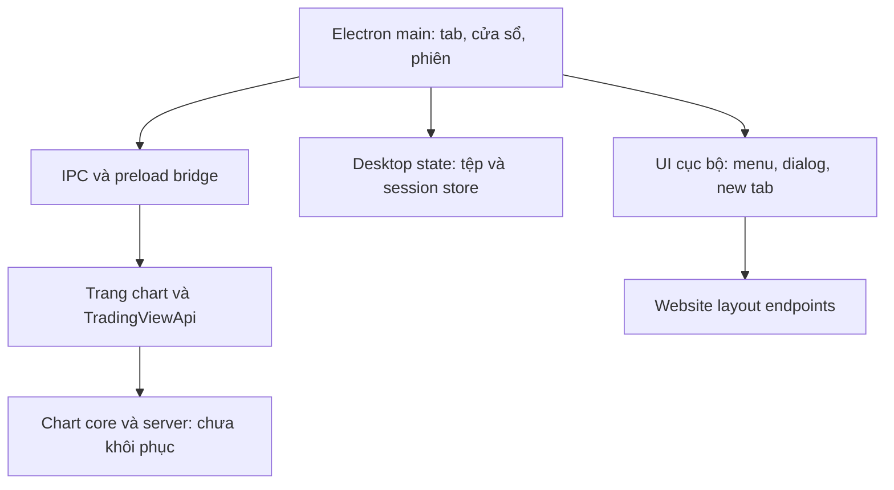

# Kiến trúc TradingView Desktop: điều đã biết và điều chưa biết

Ngày: 22/10/2026. Bằng chứng: [index](REVERSE_ENGINEERING_EVIDENCE_INDEX.md), [machine-readable records](../evidence/findings.json). `CONFIRMED` trong tài liệu này có nghĩa là xác minh tĩnh trong bộ cài, không phải hosted/runtime PASS.

## Ranh giới thành phần

Sơ đồ mô tả ranh giới khảo sát, không mô tả topology backend nội bộ của TradingView.

## Findings

| ID | Phân loại | Phát hiện và giới hạn |
|---|---|---|
| TV01 | CONFIRMED | ASAR `package.json` dùng `main: index.js`, version 3.4.1; plist macOS có Electron Framework 41.7.1. |
| TV02 | CONFIRMED | Config defaultHost là website TradingView và chart path `chart/`; desktop có adapter tới `window.TradingViewApi`. Không có bằng chứng chart core nằm trọn trong ASAR. |
| TV03 | CONFIRMED | `window-options.ts` phân biệt nội dung cục bộ/remote: BrowserView remote tắt Node integration, bật context isolation và sandbox theo nhánh `forLocalFile`. Nhánh UI local có cấu hình khác. Không suy thành audit security PASS. |
| TV04–05 | CONFIRMED | Preload công bố `TVD` qua contextBridge ở isolated context; các hành vi chọn lọc gửi/invoke IPC. Giao diện typed có thể đọc trong source map. |
| TV06 | CONFIRMED | Adapter subscribe layout, symbol, interval; đọc active chart/count; phát layout summary về desktop. Code lưu ý giá trị callback có thể mới hơn giá trị query ChartWidget API tại cùng thời điểm. |
| TV07 | CONFIRMED | Desktop persistent root restore sau đăng nhập; chờ session storage trước khôi phục; thay đổi root qua debounce rồi store. Config delay là 300000 ms. Đây là app/window session state, **không phải thời gian autosave mỗi drawing**. |
| TV08–09 | CONFIRMED | Desktop yêu cầu trang chart `saveChartToServer` bằng success/failure callbacks. Lớp TvTab có timeout 30 giây; một số scope chờ thêm 3 giây sau callback. Không đủ để biết schema/transaction backend. |
| TV10 | CONFIRMED | Shutdown helpers gom chart tabs theo persistent URL để tránh lưu cùng layout nhiều lần; luồng đóng có phản hồi thất bại/hủy. |
| TV11–12 | CONFIRMED | New-tab service list/create/clone/delete/favorite layout thông qua website endpoints với session tương ứng. Backend authorization và conflict policy chưa được khảo sát. |
| TV13 | CONFIRMED | Có sign-up modal của khu vực layout/new-tab và đường gọi mở sign-in. Không chứng minh drawing toolbar/indicator modal trên website dùng cùng component. |
| TV14 | CONFIRMED | Crosshair sync preference được chuyển qua IPC và observable; chưa thấy thuật toán chuyển time/price hoặc vẽ crosshair của chart ở module này. |
| TV15 | CONFIRMED | Session-storage backend import `ClassicLevel`; không đủ để kết luận LevelDB là kho cloud drawing. |
| TV16 | CONFIRMED | Persistence core có cơ chế gộp thông báo thay đổi và tháo subscription của persistent node. Có thể học nguyên tắc batch/disposal. |
| TV17 | CONFIRMED | Tab-linking agent có timer debounce và cleanup; đây là đồng bộ tab, không phải bằng chứng throttle hot-path của chart renderer. |
| TV18 | CONFIRMED | Windows có source map đi kèm; Linux/macOS không có `.map` trong các ASAR này. Native macOS có bốn integrity mismatch cần ghi nhận. |

## Rendering, Drawing và Indicators

| Nội dung muốn nghiên cứu | Kết quả trong bộ cài |
|---|---|
| Candlestick renderer, Canvas/SVG/WebGL pipeline | UNKNOWN cho chart core. Electron có GPU libraries chỉ chứng minh runtime hỗ trợ đồ họa, không chứng minh chart dùng WebGL. |
| Dirty regions, frame scheduler, high-DPI chart | UNKNOWN cho chart core; không gán kỹ thuật từ desktop animation hoặc danh sách layout cho chart. |
| Trendline/Fib anchors, hit testing, magnet snapping | Chưa tìm thấy implementation chart đủ để kết luận. |
| Drawing undo/redo, serialization, autosave | Chỉ thấy bridge và layout save boundary; schema, atomicity và merge policy server UNKNOWN. |
| Indicator registry, incremental math, Pine engine | Chưa tìm thấy implementation trong nguồn đã khảo sát. |
| Multi-chart layout | Có adapter summary/layout/symbol/interval; thuật toán pane renderer vẫn UNKNOWN. |
| Cloud conflict resolution và multi-device merge | UNKNOWN. Không gọi CAS của WaveAlpha là thuật toán của TradingView. |

## Bài học áp dụng độc lập

1. **Tách quyền nhìn UI khỏi quyền sử dụng dữ liệu.** Catalog tool có thể hiện cho guest; action phải qua cổng tài khoản/context/storage. Đây là yêu cầu sản phẩm của chủ WaveAlpha. TV13 hỗ trợ việc desktop có invitation modal nhưng chưa chứng minh mọi tool chart theo đúng luồng này.
2. **Thông báo thay đổi là đầu vào, ACK là kết quả lưu.** Adapter lưu phải trả success/failure cụ thể; đóng chart không được coi void callback là đã lưu. TV08–10 cho thấy boundary tương tự; cách triển khai mới trong repo là đặc tả riêng.
3. **Mỗi tầng có một owner.** Shell/tab state, chart documents và server storage có trách nhiệm khác nhau. Không dùng delay 5 phút của desktop để thiết kế autosave drawing của WaveAlpha.
4. **Chặn phiên cũ.** Lưu/restore phải giữ account, workspace, cell, symbol và timeframe trong context. Không tự động phát lại thao tác vẽ sau OAuth nếu người dùng đã đổi chart.
5. **Gộp thay đổi và dọn listener.** Áp dụng ở những boundary đo được; không tạo thêm poller hay thay render loop đã PASS chỉ vì thấy tên `debounce` trong ứng dụng khác.

## Module graph

Graph được tạo từ source ứng dụng trong source map bằng Babel 8.0.4: 790 entries, 455 source paths, 3141 relative-import edges; 2150 resolve bằng quy tắc relative `.ts/.tsx/index`, 991 chưa resolve. Các edge chưa resolve có thể là asset/CSS, module barrel, type-only hoặc code ngoài tập chọn; chưa phân loại hết. Graph giữ `map + source_index + sha256`, không gộp bừa các source trùng tên nhưng khác nội dung, không chứa source text.

Không phải call graph động. Dynamic chunks, DI, IPC channels và executeJavaScript cần boundary analysis riêng; source import không chứng minh lời gọi đã thực thi.
